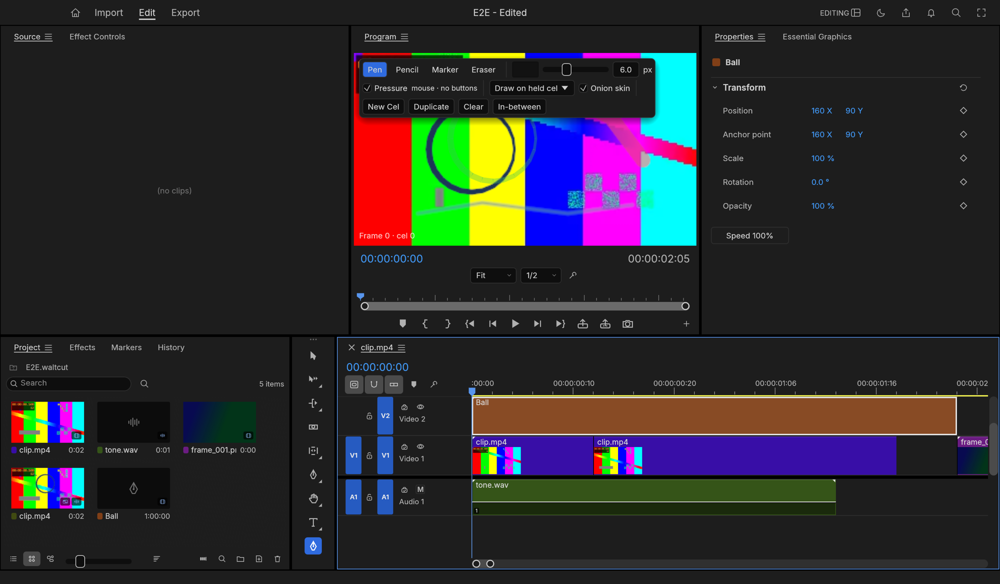
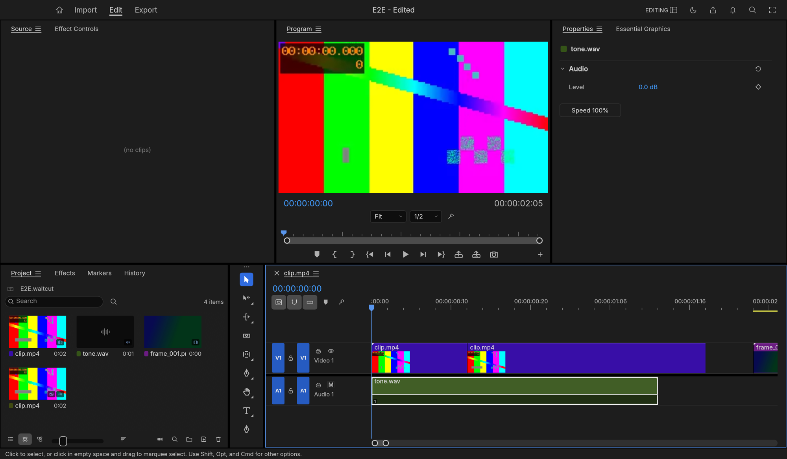
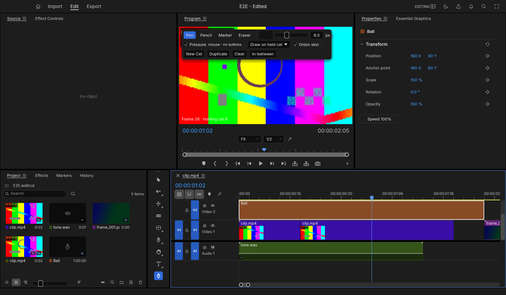

# WaltCut

WaltCut is a drawing and 2D frame-by-frame animation editor for macOS (Apple silicon). Import
footage, images and audio, arrange a simple timeline, draw and manage cels with pressure-aware
brushes and onion skinning, preview, and export. It is written in Rust.



WaltCut is a fork of [FilmCraft](https://github.com/storytold/filmcraft), reduced to the animation
workflow. The rendering, media, project and automation foundations come from FilmCraft; the
general-purpose editing features were removed. [NOTICE](NOTICE) and the
[MIT](LICENSE-MIT) / [Apache-2.0](LICENSE-APACHE) licence files carry the upstream attribution.

## Install

Download the `.dmg` from the [Releases](../../releases) page, drag **WaltCut** to **Applications**,
and the first time **right-click WaltCut ▸ Open**. Builds are not yet signed or notarized, so macOS
asks you to confirm once. Apple silicon only. Projects use the `.waltcut` extension; projects from
before the reduction do not open (use [v0.0.1-legacy](../../releases/tag/v0.0.1-legacy) for those).

## Animation workflow

1. Open a project and sequence, or create a drawing above the footage from **Graphics and Titles ▸
   New Layer ▸ New Drawing**.
2. Choose the **Brush** tool (`Shift+P`) and draw in the Program monitor. Choose Pen, Pencil,
   Marker or Eraser; use the cel mode to draw on the held cel, start a blank cel, or duplicate the
   held cel.
3. Step through the sequence, make new cels for changed poses, and use onion skins to see the
   previous and next cels. **In-between** interpolates strokes toward the next cel.
4. Optionally open **Graphics and Titles ▸ AI Restyle…** to restyle the frame at the playhead, a
   selected clip, or a sequence In/Out range (needs your own fal.ai key; see the guide for
   provider and privacy details).



See [docs/animation.md](docs/animation.md) for the full workflow, the scope of what WaltCut keeps
and removes, and current limitations.

## Audio

Audio is for timing: synchronized playback, waveforms, scrubbing, clip gain and track mute, with
a mono or stereo soundtrack. Mixing, effects and audio post-production were removed.

## Export

- **H.264 + AAC MP4**
- **ProRes 4444 MOV with alpha**, with a stereo PCM soundtrack
- **PNG sequence** with alpha, and **PNG / JPEG** still frames

Export and Quick Export share the destination, format, range, progress and Cancel. Existing movies
and stills need an explicit Replace; PNG sequences need an unused name; a failed or cancelled
export keeps the previous file. See [the export contract](crates/export/README.md).



## Build from source

```sh
cargo run --release -p waltcut                       # the desktop app
cargo run --release -p waltcut-cli -- commands       # the headless CLI
cargo run --release -p waltcut -- --control 9876     # the app with the JSON-lines control channel
```

Fonts live in [storytold/craft-fonts](https://github.com/storytold/craft-fonts) and are optional;
see [docs/contributing.md](docs/contributing.md) for the font build, the Rust setup and the quality
gates (`cargo xtask check` is the quick local gate, `cargo xtask ci` the full one), and
[AGENTS.md](AGENTS.md) for the engineering and asset rules. The release process is in
[docs/releasing.md](docs/releasing.md).

## Documentation

- [Animation guide](docs/animation.md): scope, workflow, limitations
- [Architecture](docs/architecture.md)
- [Control channel and MCP](docs/control-protocol.md) and the [agent guide](docs/agents.md)
- [Graphics and titles](docs/graphics.md)
- [Roadmap](ROADMAP.md)
